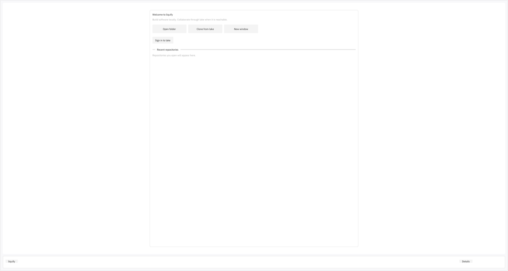
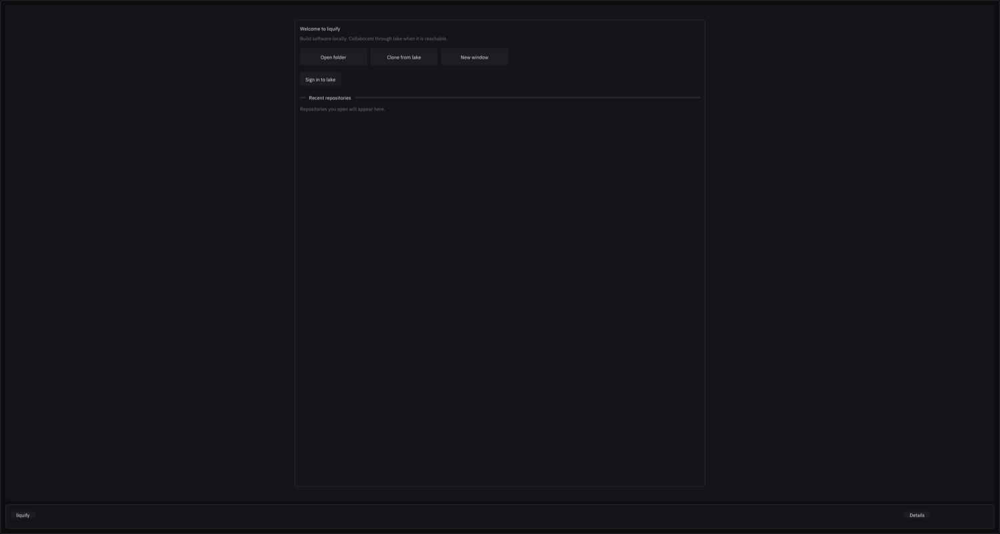
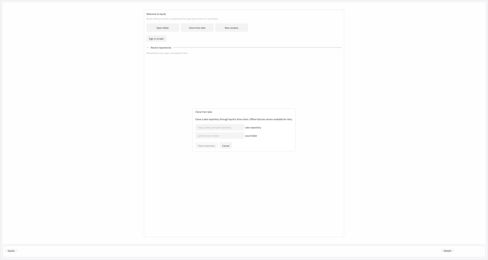
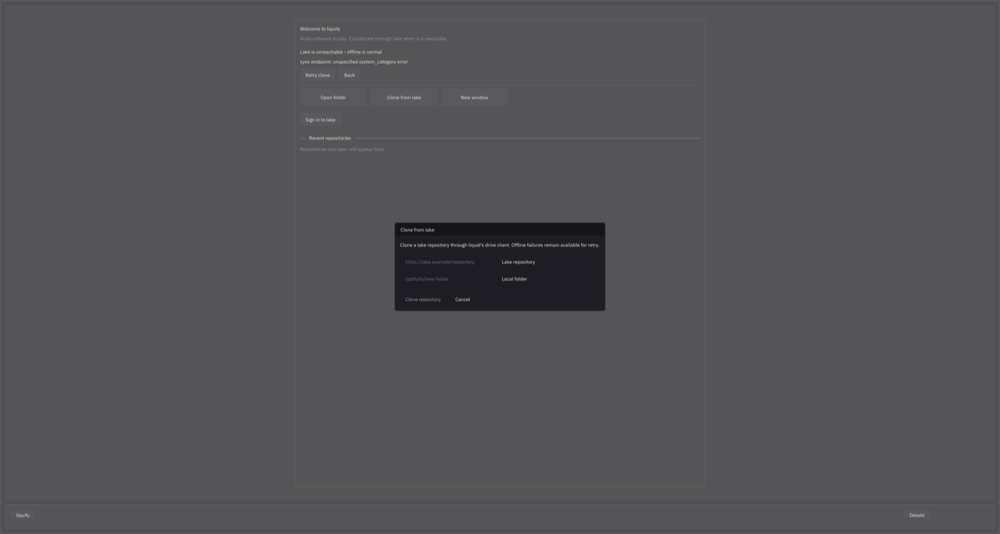
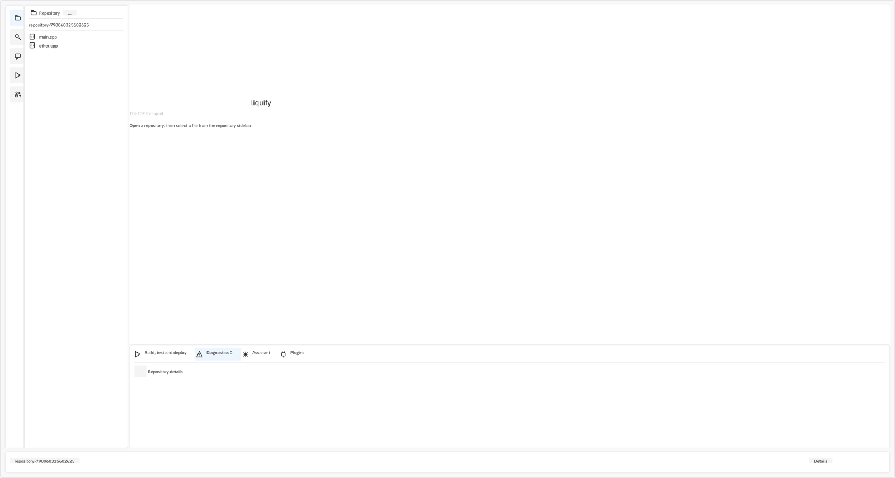
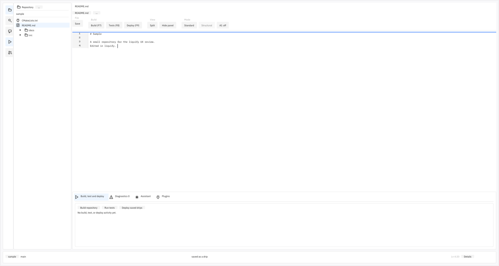
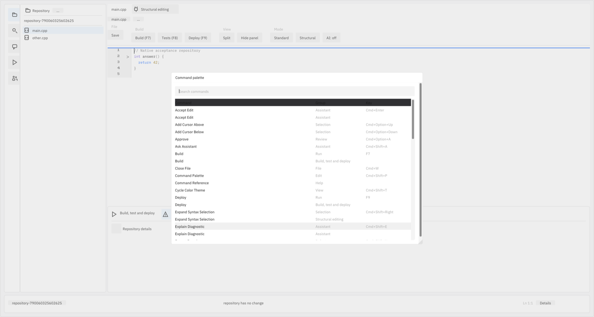

# liquify UX review, 2026-11-15

**Could not be run as written:** the desktop could not be captured from this session (no Screen Recording
permission for the terminal, no computer-use tools). Every screenshot below is the **real application window**
instead: a scratch driver links liquify's own app library, opens the GPU window at density 2, drives it through
SDL events and saves the framebuffer read back from the renderer (the same readback the native acceptance tests
use). Nothing was rendered by the headless `--screenshot` path. The driver lives outside the repository.

| | |
|---|---|
| liquify | `dc2a271` (main = dev), libliquid `27d56ba` (the bridge pin, liquid 0.2.0) |
| liquid CLI | built from the pin; a second build of liquid#382 with corosio `8783392` and `dev` merged, for the jobs the pin cannot do |
| lake | `https://lake-dev.oramadev.net`, revision `2e6024cf` (2026-10-27) |
| Style standard | lake's `docs/ui/design-system.md` on `dev` (the `orama-design` repository is out of date) |
| Ran it | Claude, for Steve, with the [`liquify-ux-review`](../../../.claude/skills/liquify-ux-review/SKILL.md) skill |
| Epic | [liquify#95](https://github.com/oramasearch/liquify/issues/95) |

## Scorecard

| # | Job | Result | Where it stalled |
|---|---|---|---|
| L1 | First launch | done with help | The front door is clear enough; nothing explains drips, changes or lake |
| L2 | Sign in to lake | **stuck** | "Sign in to lake" starts a local identity session; there is no lake sign-in in liquify |
| L3 | Get a repository | **stuck** (clone), done (open) | Every https clone fails on macOS (liquid#368, fix unmerged); no way to create a repository |
| L4 | Find my way | done with help | Tree works; Quick Open and the palette fail native acceptance (#33, #34) |
| L5 | Edit and save | **done** | Typing and Cmd+S saved a drip; status bar says "saved as a drip" |
| L6 | Build and test | stuck | F7 needs `liquid wrap` in a terminal |
| L7 | Push to lake | **stuck** | No cut in liquify; F9 is "Deploy" with no remote; from the CLI the push applied but lake then shows 0 files and the repository cannot be cloned |
| L8 | Review | done with help | With the TLS fix and `--lake`, the panel lists lake-dev's reviews; it cannot start one |
| L9 | Lake's other records | absent | Issues, releases, artifacts are not reachable from liquify |
| L10 | Collaborate | not run | Needs a second identity on lake-dev (lake#1327) |
| L11 | Make it mine | done | Settings apply live; light and dark both render |
| L12 | Recover | stuck | Errors are raw, with full paths; a clone failure is called offline; a store written by two processes could not be opened again |

**Claims:** 14 checked; 5 kept, 4 kept poorly, 3 broken, 2 absent (ledger below).
**The look:** does not match lake on type, controls, tables or surfaces (four issues).

## What happened, job by job

### L1, L2, L3: the front door and clone

Open folder, Clone from lake and New window are three equal grey buttons; "Welcome to liquify" is body size; the
card is two-thirds empty. There is no New Repository. "Sign in to lake" does not sign in to lake.

The clone dialog asks for a raw URL (`https://lake.example/repository`) and a folder, with labels to the right
of the fields and the text "Clone a lake repository through liquid's drive client". There is no token field: the
token is `LIQUID_TOKEN` in the environment, which a Dock-launched app does not have.

Cloning `ux-review-2026-11-15-liquify` from lake-dev fails with **"Lake is unreachable - offline is normal"** and
`sync endpoint: unspecified system_category error`. lake-dev answered throughout. (The dialog still open in this
frame is the driver's doing, not liquify's.) The CLI fails the same way for `https://example.com`, so every https
sync fails on macOS: liquid#368's fix (liquid#382 with corosio#19) was never merged, and liquid#382 pins a
corosio commit that `orama-main` does not contain. With that PR re-pinned to `8783392`, a clone took 2 s.

### L4, L5: the editor

The empty editor's "liquify" title floats off-centre above a left-aligned hint. Every region is a box inset in a
grey frame.

Typing into README.md and Cmd+S worked in the real window; the status bar said "saved as a drip". The toolbar has
ten equal buttons under floating group names, and Save sits higher than the rest. The tab row and the breadcrumb
both say `README.md`.

The palette's header is a black bar with dark text. Accept Edit, Build, Deploy and Explain Diagnostic each appear
twice.

### L6, L7: build and push

- **F7:** `Could not complete the operation: <full path>/.liquid-build/configuration: repository has no recorded
  build configuration; run liquid wrap <command> first`. The status bar says "see Diagnostics"; Diagnostics shows 0.
- **F9** (labelled Deploy, "Deploy saved drips"): `repository has no configured sync remote`, printed twice.
- **No cut:** none of liquify's 69 commands names a change, and lake's push instructions begin "after capturing and
  naming your changes".
- **Push from the CLI instead.** With a fresh liquid home the push is refused: `unknown signer: no identity chain
  binds this name to a key`. lake's fix is Account → Identity, a one-way switch, and an account can hold one
  computer's key. With Steve's own key (registered at sign-up) and liquid `dev` plus the TLS fix, the push applied.
  Lake then listed the change by its `taap:` key with **Files 0**, and a fresh clone failed: `corrupt: change
  author identity is unavailable`. lake-dev was built against an October liquid; liquid `dev` now requires identity
  chains; neither checks the other's version.

### L8: review

Without `--lake` the Review sidebar says "Configure with --lake <repository-url>". With it, and the TLS fix, it
reached lake-dev and listed reviews ("No reviews are available.", Refresh). It has no way to start a review.
Opening a review on a repository the review did not create was refused by the session's permission check, so
comments and approval against a live lake were not exercised; the forge test double covers them in the suite.

### L11, L12: settings and recovery

Settings apply live in both themes. The two size sliders draw different handles; keymap rows show command ids
(`settings.open`, `build.run`) under "Command palette leaf overrides"; unchecked boxes are blank squares. In dark
theme the dialog backdrop is a flat mid-grey.

With the CLI's checkout daemon serving a repository, liquify showed `Navigation index: … filesystem error: in
rename: No such file or directory [… index/run-179.idx.backend-tmp]` across the sidebar, and later `leases/lease-…
lease: backend object was not found`. One checkout written by a daemon of one liquid build, the CLI of another
and liquify ended with a `MANIFEST` naming a missing `run-22.idx`; every command on it now fails. The store held
1,202 lease files after twenty minutes.

## The look, against lake's style

| Lake's rule (`docs/ui/design-system.md`) | liquify today | Issue |
|---|---|---|
| Eyebrow, one title, supporting copy; a type scale | One small size everywhere | [#100](https://github.com/oramasearch/liquify/issues/100) |
| Primary, secondary, destructive buttons; labelled controls | Equal grey buttons; blank checkboxes; labels right of fields | [#101](https://github.com/oramasearch/liquify/issues/101) |
| Compact tables with sticky headers | Black header bar, unreadable | [#109](https://github.com/oramasearch/liquify/issues/109) |
| Flat surfaces, hairline boundaries, shadows only on overlays | Boxes in grey frames with gaps; tall status bar; washed-out dark scrim | [#102](https://github.com/oramasearch/liquify/issues/102) |
| IBM Plex Sans and Mono | IBM Plex Sans and Mono | kept |
| Light first, full dark pair | Both render; dark follows the setting live | kept |

## Claims ledger

| Claim | Source | Verdict | Evidence |
|---|---|---|---|
| "Clone from lake" | front door | broken | every https clone fails on macOS (liquid#368) |
| "Sign in to lake" | front door | broken | starts a local identity session only |
| "Collaborate through lake when it is reachable" | front door | kept poorly | possible only from the CLI, with the TLS fix |
| Save writes a drip | `docs/design/status.md` | kept | real window, status bar "saved as a drip" |
| F9 pushes saved drips to the sync remote | command reference | kept poorly | named Deploy; no remote after liquify's clone |
| Review panel pulls lake changes and lists reviews | `docs/editor/review.md` | kept poorly | works only with `--lake` and the unmerged TLS fix |
| Status bar reports actionable failure state | `docs/ui/first-run.md` | kept poorly | points at Diagnostics, error is in Build |
| Light and dark themes, IBM Plex | `docs/ui/design-system.md` | kept | real window, both themes |
| Settings apply live | `docs/ui/settings.md` | kept | real window |
| Typing and saving through SDL | native acceptance `edit` (`WILL_FAIL`, #39) | kept | typed and saved in the real window here |
| Quick Open, the palette | native acceptance (`WILL_FAIL`, #33, #34) | broken | still marked failing |
| Lake's *Clone and push*: token, clone, push | lake repository page | kept poorly | push needs an own identity the panel does not mention; then clone fails (lake#1325) |
| Lake mentions liquify | lake docs, `llms.txt` | absent | not named anywhere |
| liquid picks a lake and checks its version | — | absent | liquid#525 |

## Findings, ranked

**Blocks a person**
1. https sync fails on macOS; the fix is unmerged and mis-pinned: [liquid#368](https://github.com/oramasearch/liquid/issues/368) (reopened), [liquid#382](https://github.com/oramasearch/liquid/pull/382) (assigned to Steve).
2. lake-dev accepts a push it cannot serve back: [lake#1325](https://github.com/oramasearch/lake/issues/1325).
3. A store written by two processes corrupts: [liquid#526](https://github.com/oramasearch/liquid/issues/526), [liquify#97](https://github.com/oramasearch/liquify/issues/97).
4. No cut, no push to lake, no review start in liquify: [#103](https://github.com/oramasearch/liquify/issues/103), [#104](https://github.com/oramasearch/liquify/issues/104), [#105](https://github.com/oramasearch/liquify/issues/105).
5. Which lake, at which version: [liquid#525](https://github.com/oramasearch/liquid/issues/525), [lake#1324](https://github.com/oramasearch/lake/issues/1324), [liquify#96](https://github.com/oramasearch/liquify/issues/96).
6. A first push needs a one-way identity switch nobody mentions; one computer per account: [lake#1327](https://github.com/oramasearch/lake/issues/1327).

**Damages trust**
7. A failed clone is called offline: [#98](https://github.com/oramasearch/liquify/issues/98).
8. Raw errors with paths, twice, in the wrong panel: [#99](https://github.com/oramasearch/liquify/issues/99).
9. Unreadable table headers: [#109](https://github.com/oramasearch/liquify/issues/109).
10. Authors shown as keys: [lake#1326](https://github.com/oramasearch/lake/issues/1326).

**The look**
11. Type, controls, surfaces: [#100](https://github.com/oramasearch/liquify/issues/100), [#101](https://github.com/oramasearch/liquify/issues/101), [#102](https://github.com/oramasearch/liquify/issues/102).

**Rough edges**
12. Front door: no New Repository; sign-in label: [#106](https://github.com/oramasearch/liquify/issues/106).
13. Build setup needs a terminal: [#107](https://github.com/oramasearch/liquify/issues/107).
14. Two kinds of token; the liquid preset cannot review: [lake#1328](https://github.com/oramasearch/lake/issues/1328).
15. Leases leak: [liquid#527](https://github.com/oramasearch/liquid/issues/527).
16. Duplicate palette commands: comment on [#34](https://github.com/oramasearch/liquify/issues/34).
17. Tests: hard-coded version, shared temp directory: [#108](https://github.com/oramasearch/liquify/issues/108).
18. CLI: `cut -m`, `daemon stop`: [liquid#528](https://github.com/oramasearch/liquid/issues/528).

## What is good

- The editor types, saves as a drip, keeps undo and shows the repository tree in the real GPU window, at Retina
  density, quickly.
- With the TLS fix, liquify's review panel and liquid's clone reach a real lake on the first try, in seconds.
- Settings, both themes and lake's fonts are already in place: the look is a matter of applying lake's kit, not
  of new infrastructure.
- lake's repository page gives the exact clone and push commands with the real URL.

## What the review created

On lake-dev, left for Steve's call (delete only with his yes):
- Repository `still-mesa-354/ux-review-2026-11-15-liquify`, with one pushed change (now unclonable, lake#1325)
  and an open review.
- API token `ux-review-2026-11-15`, expiring 2026-11-16.

On this Mac, in the session scratchpad: the scratch liquid worktree and builds, the sample repositories, and the
driver. Nothing in the repositories' checkouts was changed.
